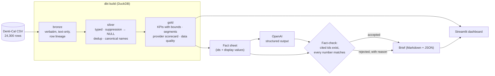

# Dental Analytics Medallion

[](https://github.com/gcfialho/dental-analytics-medallion/actions/workflows/ci.yml)


[](LICENSE)

A medallion data pipeline (bronze → silver → gold) over California's public Medi-Cal
dental utilization data, built with **dbt + DuckDB**, served through a **Streamlit**
dashboard, and summarized by an **LLM brief whose every number is fact-checked**
against the warehouse before anyone reads it.

Runs locally with one command. No database server, no cloud account.


## Why this project is interesting

This is v2 of a take-home exercise. Auditing v1 showed that its headline numbers were
wrong: it double-counted services, treated privacy-suppressed counts as zero, kept
duplicate rows, and labeled a template as "AI-generated". v2 rebuilds the pipeline
around those findings and locks each correction in with a test.
**[Read the data audit →](docs/data-audit.md)**

<!-- RESULTS -->

## Architecture



| Layer | Models | Responsibility |
|---|---|---|
| Bronze | `bronze_denti_cal_utilization` | Load the file exactly as published. Every value is text, plus source file and row number. |
| Silver | `silver_provider_utilization`, `silver_providers` | Types, trimmed names, suppressed counts as `NULL` with flags, exact-duplicate removal, labelled delivery systems and age groups, row-level rates. |
| Gold | `gold_program_kpis`, `gold_segment_summary`, `gold_provider_scorecard`, `gold_data_quality` | Ratio-of-sums rates, patient bounds under suppression, empirical-Bayes provider ranking, robust outlier screen, data-quality profile. |

`dbt build` runs the models and the data tests together. A failed invariant stops the
pipeline before the dashboard or the LLM sees bad data.

## Quickstart

Requires [uv](https://docs.astral.sh/uv/).

```bash
git clone https://github.com/gcfialho/dental-analytics-medallion.git
cd dental-analytics-medallion
uv sync

uv run dental pipeline           # dbt build: bronze → silver → gold + data tests
uv run dental brief --offline    # deterministic brief, no API key needed
uv run dental dashboard          # http://localhost:8501
```

To generate the brief with an LLM, set `OPENAI_API_KEY` (see `.env.example`) and run
`uv run dental brief`. The model defaults to `gpt-5-mini`; override with `--model` or
`OPENAI_MODEL`.

Other entry points: `make docs` (dbt docs and lineage graph), `make test`, `make lint`,
or `docker build -t dental . && docker run -p 8501:8501 dental`.

## Analytical choices

- **ADV is the total.** "Annual dental visit" counts any dental service. Preventive,
  treatment and exam counts are subsets of it, which a dbt test checks on every row.
- **Suppressed means unknown, not zero.** The source withholds patient counts from 1 to
  10. Rates use only rows where both sides are published, and patient totals are
  reported as a range.
- **Ratios of sums, not averages of ratios.** An 11-patient practice does not weigh as
  much as a 70,000-patient clinic.
- **Shrink before you rank.** A practice with 3 out of 3 patients is not "100%
  preventive". Provider preventive coverage uses empirical-Bayes beta-binomial
  shrinkage per age group (method-of-moments prior with sampling variance removed).
- **Outliers are a screen, not a verdict.** Service intensity is flagged with a
  modified z-score (median/MAD > 3.5), which is robust to the heavy right tail.
- **Patients are provider-level.** Counts are unique per provider, so totals count a
  patient once per provider seen. The UI and the brief say so.

## The LLM brief and its guardrails

The model never sees raw rows. It receives a fact sheet built from gold: one entry per metric, each
with a stable id, a label and a display value. It must return a Pydantic
`InsightsBrief` via OpenAI structured outputs, citing fact ids for every finding.

Before display, `guardrails.verify_brief`:

1. rejects findings that cite no facts or unknown ids,
2. extracts every number in the text (`66.1%`, `6,842,769`, `6.8 million`) and requires it to be
   a correct rounding of one of the **cited** facts, at the precision written,
3. checks the headline against the whole fact sheet.

Rejected findings are listed with the reason in the brief instead of being silently
dropped. The offline brief goes through the same checks, and CI fails if it does not
pass them.

## Project structure

```
├── data/raw/denti_cal_2018.csv     # source extract (public data)
├── transform/                      # dbt project
│   ├── models/{bronze,silver,gold}/
│   ├── tests/                      # singular + generic data tests
│   └── macros/
├── src/dental_analytics/
│   ├── cli.py                      # `dental pipeline | brief | dashboard`
│   ├── pipeline.py                 # programmatic dbt build
│   ├── insights/                   # facts, LLM, guardrails, offline brief, report
│   └── dashboard/app.py            # Streamlit
├── tests/                          # pytest: guardrails, LLM contract, warehouse invariants
├── reports/latest_brief.md         # most recent brief
└── docs/data-audit.md              # what v1 got wrong
```

## Testing

```bash
uv run pytest      # unit tests + a full dbt build into a temp warehouse
make lint          # ruff check + ruff format --check
```

CI (GitHub Actions) runs lint, `dbt build` with all data tests, the offline brief
fact-check and pytest on every push and pull request.

## Data

[Dental Care Utilization by Rendering Provider](https://data.chhs.ca.gov/), California
Department of Health Care Services (Denti-Cal), calendar year 2018, via the CHHS Open
Data Portal. ADV = annual dental visit (any service), PREV = preventive, TXMT =
treatment, EXAM = examination. FFS = Fee-for-Service, GMC = Geographic Managed Care,
PHP = Prepaid Health Plan. SNC = safety net clinic.

**Limitations.** One year only. Utilization is not clinical quality. Suppression hides
small practices disproportionately. Provider-level patient counts are not distinct
beneficiaries.

## Roadmap

- Multi-year extract to add trends and incremental models.
- BigQuery target (`dbt-bigquery` profile) and an Airflow/Composer DAG for scheduled runs.
- An evaluation set for the brief: score factual precision and coverage across models
  and prompts.

## Author

**Guilherme Fialho** · Machine Learning Engineer (GenAI/LLMs) and Data Engineer
[LinkedIn](https://www.linkedin.com/in/guilherme-cagide-fialho/) · [GitHub](https://github.com/gcfialho)
