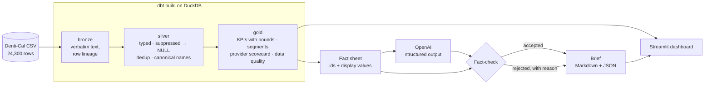

# Dental Analytics Medallion

A medallion data pipeline (bronze → silver → gold) over California's public Medi-Cal
dental data, built with dbt + DuckDB, with a Streamlit dashboard and an LLM brief whose
every number is fact-checked against the warehouse.

[](https://github.com/gcfialho/dental-analytics-medallion/actions/workflows/ci.yml)


[](LICENSE)

<!-- hero: docs/img/dashboard-overview.png (screenshot pending) -->

## Highlights

- **Data modelling with dbt.** Bronze/silver/gold layers on DuckDB, with documented
  models and data tests that stop the build when an invariant breaks.
- **Data auditing.** v2 found and fixed double-counted services, privacy-suppressed
  values treated as zero, and duplicate rows. Each fix is pinned by a test.
  [Read the audit →](docs/data-audit.md)
- **Sound statistics.** Ratios of sums, bounds under suppression, empirical-Bayes
  shrinkage for provider rankings and a robust outlier screen.
- **LLM with guardrails.** OpenAI structured outputs over a curated fact sheet. A
  validator rejects any finding whose numbers do not match the facts it cites.
- **Runs anywhere.** One command, no database server, no cloud account. CI runs the full
  build and tests on every push.

## Quickstart

Requires [uv](https://docs.astral.sh/uv/).

```bash
git clone https://github.com/gcfialho/dental-analytics-medallion.git
cd dental-analytics-medallion
uv sync

uv run dental pipeline           # dbt build: bronze → silver → gold + data tests
uv run dental brief --offline    # deterministic brief, no API key needed
uv run dental dashboard          # http://localhost:8501
```

For the LLM brief, set `OPENAI_API_KEY` (see `.env.example`) and run `uv run dental brief`.
The model defaults to `gpt-5-mini`; override it with `--model` or `OPENAI_MODEL`.

Also available: `make docs` (dbt docs and lineage graph), `make test`, `make lint`, and
`docker build -t dental . && docker run -p 8501:8501 dental`.

## How it works



| Layer | Models | Responsibility |
|---|---|---|
| Bronze | `bronze_denti_cal_utilization` | Load the file exactly as published: text only, plus source file and row number. |
| Silver | `silver_provider_utilization`, `silver_providers` | Types, suppressed counts as `NULL` with flags, exact-duplicate removal, labelled delivery systems and age groups, row-level rates, canonical provider names. |
| Gold | `gold_program_kpis`, `gold_segment_summary`, `gold_provider_scorecard`, `gold_data_quality` | Program KPIs with suppression bounds, ratio-of-sums segments, empirical-Bayes scorecard, outlier screen, data-quality profile. |

`dbt build` runs models and data tests together, so bad data never reaches the
dashboard or the LLM.

## Results

Denti-Cal, calendar year 2018: 10,849 rendering providers, 24,300 source rows.

| Metric | v1 (before audit) | v2 |
|---|---|---|
| Dental services | 71,211,862 | **42,560,256** |
| Services per patient | 10.41 | **6.34** |
| Provider-level patients | 6,842,769 | **6,713,211** published (6.72M–6.77M with suppressed rows) |
| Rows with suppressed patient counts | treated as 0 | **24.2%**, excluded from rates |
| Duplicate rows | kept | **505** removed |

Share of patients who received each type of care:

| Age group | Preventive | Exam | Treatment | Services per patient |
|---|---|---|---|---|
| 0–20 | 79.2% | 73.4% | 38.6% | 7.23 |
| 21+ | 47.5% | 61.8% | 60.7% | 4.89 |

Children are mostly seen for prevention, while adults are more often seen for
treatment. By delivery system, preventive coverage is 67.6% in Fee-for-Service, 65.1% in
Prepaid Health Plans and 56.4% in Geographic Managed Care.

These values were computed independently from the raw CSV and are pinned by
`tests/test_warehouse.py`.

## Methodology

- **ADV is the total.** "Annual dental visit" counts any dental service. Preventive,
  treatment and exam counts are subsets of it, which a dbt test checks on every row.
- **Suppressed means unknown, not zero.** The source withholds patient counts from 1 to
  10 (the smallest published count is 11). Rates use only rows where both sides are
  published, and patient totals are reported as a range.
- **Ratios of sums, not averages of ratios.** An 11-patient practice does not weigh as
  much as a 70,000-patient clinic.
- **Shrink before you rank.** 3 out of 3 patients is not "100% preventive". Provider
  preventive coverage uses empirical-Bayes beta-binomial shrinkage per age group
  (method-of-moments prior, with sampling variance removed from the between-provider
  variance).
- **Outliers are a screen, not a verdict.** Service intensity is flagged by modified
  z-score (median/MAD > 3.5), which is robust to the heavy right tail.
- **Patients are provider-level.** Counts are unique per provider, so a patient seen by
  two providers counts twice. The dashboard and the brief say so.

### The LLM brief and its guardrails

The model never sees raw rows. It gets a fact sheet built from gold, where each fact has
a stable id, a label and a display value. It must return a Pydantic `InsightsBrief`
through OpenAI structured outputs and cite fact ids for every finding.

Before anything is shown, `guardrails.verify_brief`:

1. rejects findings that cite no facts or unknown ids;
2. extracts every number in the text (`66.1%`, `6,842,769`, `6.8 million`) and requires
   it to be a correct rounding of one of the **cited** facts, at the precision written;
3. checks the headline against the whole fact sheet.

Rejected findings are listed with the reason instead of being silently dropped. The
offline brief goes through the same checks, and CI fails if it does not pass them.

## Project structure

```
├── data/raw/denti_cal_2018.csv     # source extract (public data)
├── transform/                      # dbt project
│   ├── models/{bronze,silver,gold}/
│   ├── tests/                      # singular and generic data tests
│   └── macros/
├── src/dental_analytics/
│   ├── cli.py                      # dental pipeline | brief | dashboard
│   ├── pipeline.py                 # programmatic dbt build
│   ├── insights/                   # facts, LLM, guardrails, offline brief, report
│   └── dashboard/app.py            # Streamlit
├── tests/                          # pytest: guardrails, LLM contract, warehouse invariants
└── docs/data-audit.md              # what v1 got wrong and how v2 fixes it
```

## Testing

```bash
uv run pytest      # unit tests + a full dbt build into a temporary warehouse
make lint          # ruff check + ruff format --check
```

On every push and pull request, CI runs lint, `dbt build` with all data tests, the
offline brief fact-check and pytest.

## Limitations & roadmap

**Data.** [Dental Care Utilization by Rendering Provider](https://data.chhs.ca.gov/),
California Department of Health Care Services (Denti-Cal), via the CHHS Open Data Portal.
ADV = annual dental visit, PREV = preventive, TXMT = treatment, EXAM = examination;
FFS = Fee-for-Service, GMC = Geographic Managed Care, PHP = Prepaid Health Plan;
SNC = safety net clinic.

**Limitations.** One year only. Utilization is not clinical quality. Suppression hides
small practices disproportionately. Provider-level patient counts are not distinct
beneficiaries. This project began as an analytics take-home exercise and was rebuilt as
v2 after an audit.

**Roadmap**
- Multi-year extract, to add trends and incremental models.
- BigQuery target (`dbt-bigquery`) and an Airflow/Cloud Composer DAG for scheduled runs.
- An eval set for the brief, scoring factual precision and coverage across models and
  prompts.

## Author

**Guilherme Fialho** · Machine Learning Engineer (GenAI/LLMs) and Data Engineer ·
[LinkedIn](https://www.linkedin.com/in/guilherme-cagide-fialho/) · [GitHub](https://github.com/gcfialho)
